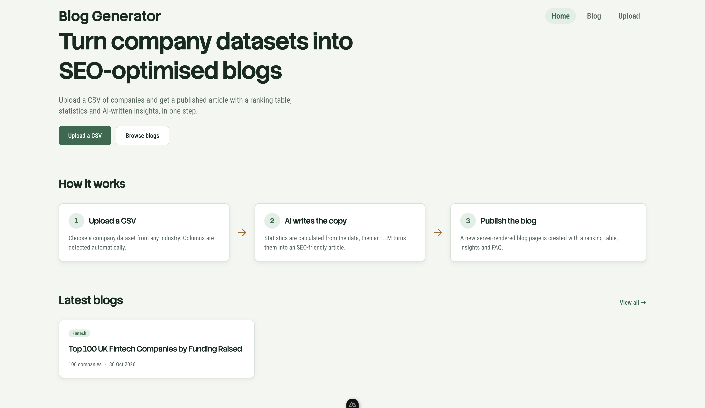
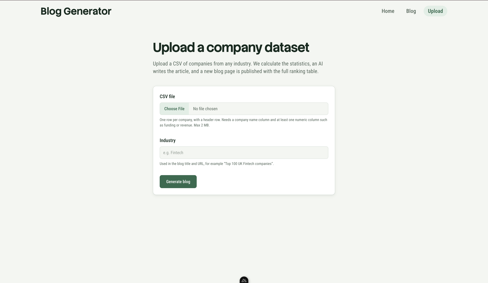
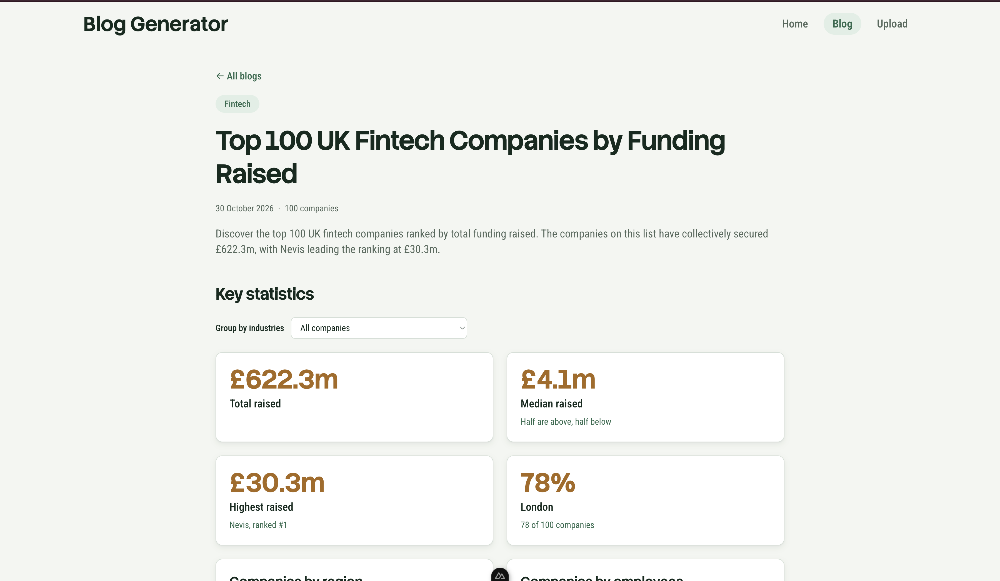
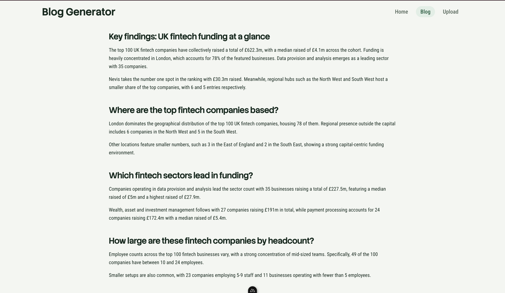
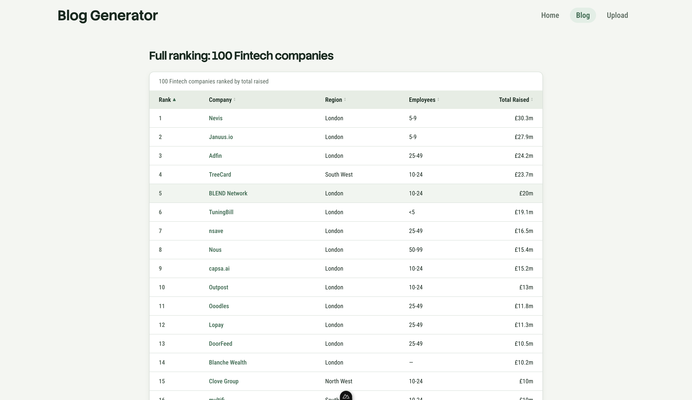
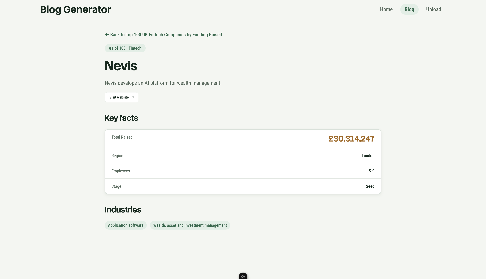
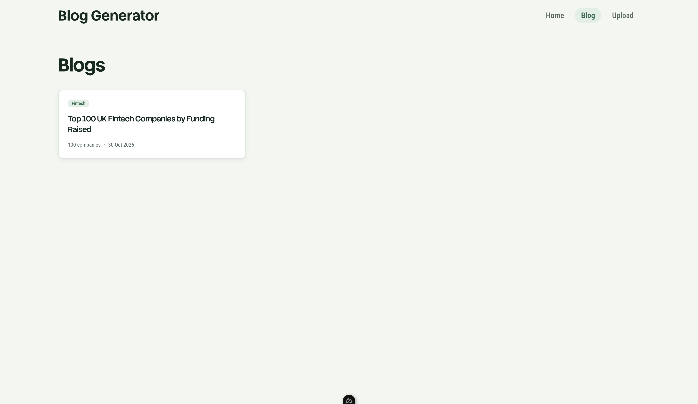

# AI-Powered SEO Blog Generator

Upload a CSV of companies from any industry and get a published, SEO-optimised blog page: an AI-written article, key statistics, an interactive ranking table and a page for every company. Built with Nuxt for the Beauhurst Graduate/Junior Web Developer assessment.

The same template works for any dataset. Nothing is hardcoded for fintech: column types, the ranking metric and the statistics are all detected from the uploaded file.

## Setup

**Requirements:** Node 24 (LTS) and [Bun](https://bun.sh). npm works too.

```bash
bun install                # or: npm install
cp .env.example .env       # then add your Gemini API key
bun run dev                # or: npm run dev
```

Open http://localhost:3000.

### Environment variables

| Variable | Required | Default | Purpose |
|---|---|---|---|
| `NUXT_GEMINI_API_KEY` | For AI copy | (none) | Free key from [Google AI Studio](https://aistudio.google.com) |
| `NUXT_GEMINI_MODEL` | No | `gemini-3.5-flash-lite` | Which Gemini model writes the copy |
| `NUXT_LLM_PROVIDER` | No | auto | `gemini` or `stub`. Empty = Gemini when a key is set, otherwise the stub |

Without a key the app still works: the **stub** writes simple copy from the statistics instead of calling the AI. All statistics, the ranking table and company pages are identical either way.

### Scripts

| Command | What it does |
|---|---|
| `bun run dev` | Start the dev server |
| `bun run reset` | Clear Nuxt's caches **and delete all saved blogs** (`data/`), then start the dev server |
| `bun run build` / `bun run preview` | Production build / preview it |

## How to use

1. Go to **Upload**, choose a CSV and enter the industry (e.g. "Fintech").
2. Press **Generate blog**. Parsing and statistics take milliseconds; the AI step takes a few seconds.
3. You are redirected to the new blog at `/blog/<id>/<slug>`. Every company name in the ranking table links to its own page.

All blogs are listed on **Blog** and the newest on the home page. Each upload creates a new blog; nothing is overwritten.

## Screenshots

**Home**



**Upload**



**Blog: title, introduction and key statistics** (the statistics can be grouped by industry)



**Blog: AI-written article** with a key findings summary and question-style headings



**Blog: sortable ranking table** with every company linking to its own page



**Company page**



**All blogs**



### Supported CSV format

- A header row and one row per company.
- **Required:** a company name column and at least one numeric column to rank by (e.g. funding or revenue).
- **Used if present:** a rank column; single-value columns such as region, stage or team size (become breakdowns); `;`-separated list columns such as industries (become tag breakdowns and the "group by" filter); a description and a website.
- Values like `£30,314,247`, `£1.2bn`, `12.5` under a `Revenue (£m)` header, ranges such as `<5` / `10-24` / `1,000+` and `N/A` are all understood.
- Max 2 MB / 1,000 rows. Files that can't work (no header, no name column, no numeric column) get a clear error message instead of a broken page.

## Approach

```
Upload page ──POST /api/upload──▶ parse CSV ─▶ detect columns ─▶ compute stats ─▶ 1 Gemini call ─▶ validate ─▶ save
                                  (Papa Parse)  (types + roles)   (in code)        (JSON only)       (retry once)   (JSON file)

/blog/<id>/<slug> ──useFetch──▶ GET /api/blogs/<id> ──▶ read saved JSON ──▶ server-rendered page (no AI on page load)
```

**Key decisions**

- **The AI is called once per blog, at upload time.** The result is saved, so blog pages are instant for every visitor and never depend on the AI being available.
- **Numbers are calculated in code, never by the AI.** `stats.ts` computes totals, medians, breakdowns and per-industry figures, with sanity checks (e.g. breakdown counts must add up to the number of companies). The AI only writes prose around those numbers, which are passed to it already formatted.
- **The AI returns structured JSON, not HTML.** Gemini fills `title`, `metaDescription`, `introduction` and `sections` via a JSON schema. The Vue template owns all HTML, so semantic markup and heading order are guaranteed, and AI text is always rendered as escaped text (never `v-html`).
- **Column detection makes it reusable.** `csv.ts` gives every column a *type* from its values (`text`, `number`, `money`, `range`, `list`, `url`) and picks four *roles* from header words plus type (`name`, `rank`, `metric`, `description`), with value-based fallbacks. The table, statistics, company pages and the AI prompt all use these instead of column names.
- **Storage** uses Nitro's `useStorage` with the `fs` driver: one JSON file per blog plus an `index.json` of summaries for the list pages. Moving to serverless hosting only needs a different driver (e.g. Upstash or Netlify Blobs) in `nuxt.config.ts`; no code changes.

### Project structure

```
app/
  pages/
    index.vue                      home: hero, how it works, latest blogs
    upload.vue                     upload form
    blog/index.vue                 all blogs
    blog/[id]/[slug]/index.vue     the blog template
    blog/[id]/[slug]/[company].vue company page
  components/                      navbar, cards, statistics panel, breakdowns, ranking table
server/
  api/upload.post.ts               upload → parse → stats → copy → save
  api/blogs/index.get.ts           list of blog summaries
  api/blogs/[id].get.ts            one full blog
  utils/csv.ts                     parsing, column types and roles, cleaning, ranking
  utils/stats.ts                   highlights, breakdowns, grouping, sanity checks
  utils/llm.ts                     Gemini prompt, structured output, validation, stub
  utils/blogStore.ts               saving and reading blogs
shared/types/blog.ts               types used by both app and server
```

## SEO

SEO is handled in two layers: **technical SEO is guaranteed by the template**, and **content SEO is written by the AI** under rules that are validated in code.

### Technical (every page)

- **Server-rendered.** Every page is rendered on the server, so search engines get the full content in the HTML without running JavaScript, including the whole article, the statistics and all rows of the ranking table. Interactive features (sorting the table, the "group by industry" filter, the mobile menu) only change what is shown after load; their default state is in the server HTML.
- **Semantic HTML.** `<main>`, `<article>`, `<header>`, `<section>` with `aria-labelledby`, `<nav>`, one `<h1>` per page with `<h2>`/`<h3>` in order, `<time datetime>`, `<figure>`/`<figcaption>` for breakdowns, `<dl>` for company facts, and a real `<table>` with `<caption>`, `<th scope="col">` and `<th scope="row">`.
- **Metadata on every page** via `useSeoMeta`: a unique `<title>` and meta description on the home, blog list and upload pages, and on every blog and company page.
- **Blog and company pages** also have Open Graph tags (title, description, URL, type) for link previews and a canonical URL.
- **Clean, keyword-rich URLs:** `/blog/k7p2x9qa/top-100-fintech-companies/capsa-ai`. Blogs are looked up by id; if the slug in the URL is wrong or out of date, the page **301-redirects** to the canonical URL, so every blog has exactly one indexable address.
- **Internal links:** home → blog list → blog → every company → back to the ranking.
- **Accessibility**, which overlaps with SEO: labelled form fields, visible focus styles, `aria-current` on the active nav link, screen-reader text for icon buttons, `<html lang="en-GB">`.

### Content (written by the AI for each blog)

For every uploaded dataset, Gemini writes the blog's **title, meta description, introduction and article sections**. The prompt requires:

- a title of at most 60 characters that matches search intent (e.g. "Top 100 UK Fintech Companies by Funding Raised");
- a meta description of 120–160 characters;
- an introduction that answers the search query straight away;
- a "key findings" summary first, then question-style, keyword-rich `<h2>` sections;
- short paragraphs where every insight is backed by a number from the dataset, using natural related terms rather than keyword stuffing.

The reply is validated in code (lengths, no empty sections, no HTML/Markdown). If it fails, the AI is asked once more with the exact problems listed; if the title or description is still slightly long, it is trimmed at a word boundary.

**Company pages** don't use the AI: their title, description and facts come straight from the CSV, so they cost nothing to generate.

### Safety

- CSV content is sent to the AI inside `<dataset>` tags and the system prompt says it is data, not instructions, so a cell like "ignore previous instructions" is just text.
- Only `http(s)` links from the CSV are used as website links; external links use `rel="nofollow noopener noreferrer"`.
- The API key is server-only (`runtimeConfig`) and never reaches the browser; `.env` is gitignored.
- Uploads are validated in the browser for quick feedback and again on the server.

## Tools used

| Tool | Purpose |
|---|---|
| Nuxt 4, Vue 3, TypeScript | Framework, server rendering, API routes |
| Tailwind CSS v4 | Styling, with a small design-token theme |
| Papa Parse | CSV parsing |
| Google Gemini API (free tier) | Blog copy, using structured JSON output |
| Nitro storage (`fs` driver) | Saving blogs as JSON |
| Claude Code | AI coding assistant (see below) |

**How I used AI:** I hadn't used Vue or Nuxt before, so I used Claude Code as a pair programmer while learning, comparing each Vue/Nuxt concept with its React/Next.js equivalent. I made the product, architecture and SEO decisions, such as one blog per CSV, id + slug URLs with 301 redirects, JSON-only AI output, stats calculated in code, and keeping SEO content server-rendered. I questioned and changed its suggestions, for example checking that statistics add up, how multi-value industry columns should be counted, how employee ranges should sort, and whether tabs would hide content from search engines. Much of the code was written by the assistant and reviewed by me step by step; the commit history shows the build stage by stage.

Free-tier note: Google may use content sent to the Gemini free tier to improve its products. That's acceptable here because the data is public company information.

## Time

The brief estimates 2–3 hours. This took longer because I was learning Vue and Nuxt at the same time, and I spent extra time on SEO and on handling different CSV formats.

## Trade-offs and next steps

- **Database:** JSON files are simple and transparent but don't support querying or concurrent writes (two uploads finishing at the same moment could race on `index.json`). A database such as Postgres would fix both.
- **Hosting:** the `fs` driver needs a writable disk; for serverless hosting, swap to a hosted storage driver.
- **Structured data:** add JSON-LD (`Article` + `ItemList` for the ranking, `Organization` for company pages), an FAQ section and a `sitemap.xml`.
- **Regenerate / edit:** protected by an admin token, replacing a blog only after the new copy passes validation; the id + slug URLs already keep old links working if the title changes.
- **Batch uploads:** process many CSVs through a queue with rate limiting to stay within AI limits.
- **Column override:** let the uploader change the detected ranking metric if detection guesses wrong.
- **Charts:** richer visualisations, kept server-rendered.
